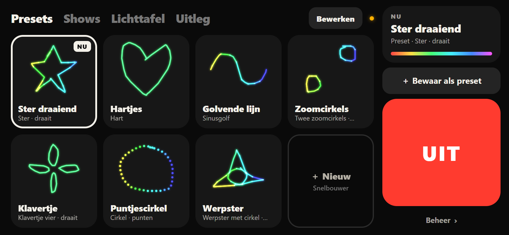
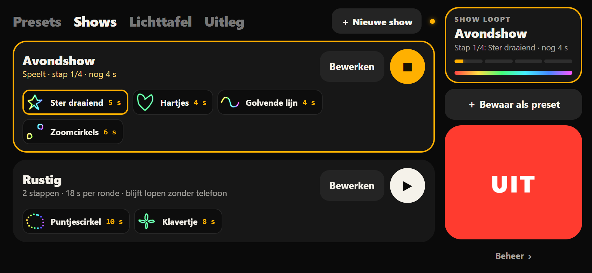
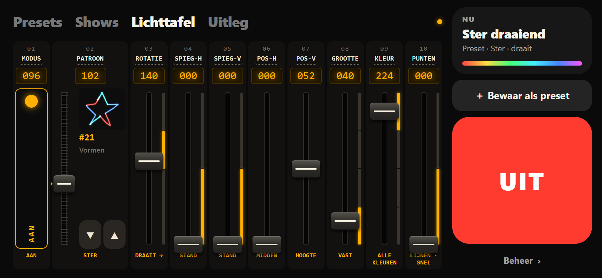
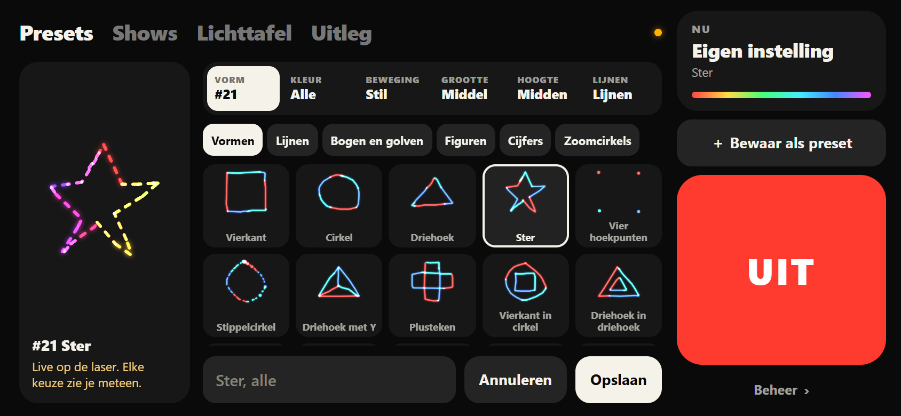
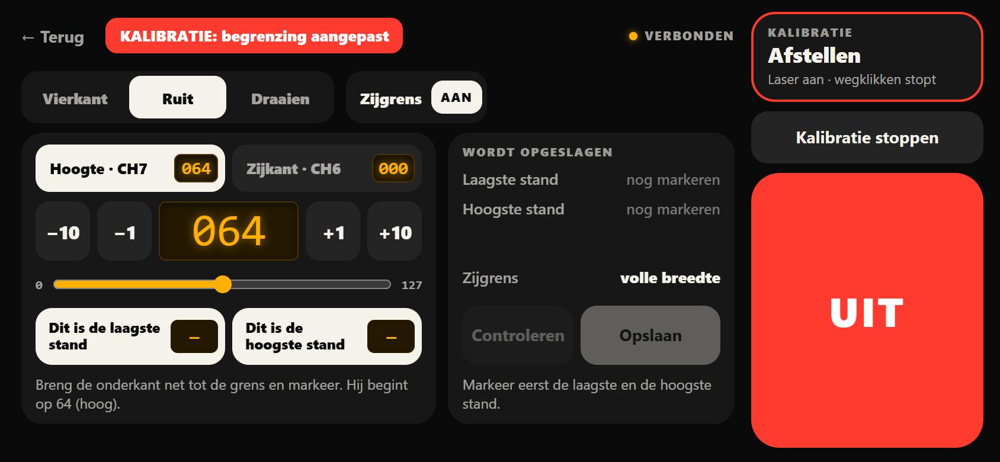

# Schuwe Lichten

A pocket DMX lighting controller: **phone → WiFi → ESP32 → DMX → light**.

Right now it drives one cheap RGB laser. You tap presets on your phone, build looping shows that keep playing when you lock the phone,
and fine-tune every channel on a lighting-desk page. A height limit set on site keeps the beam up, and the ESP32 enforces it on every DMX frame,
whatever the phone asks for. Everything fits in a small 3D-printed box with an XLR socket.



> [!WARNING]
> This drives a **500 mW laser**, which can blind people instantly, also through a reflection.
> The height limit and stop button make mistakes less likely; they are **not** a certified safety system.
> Never aim at people, follow your local laser regulations, and keep the laser's own power switch within reach.
> See [docs/SAFETY.md](docs/SAFETY.md).

## Features

- **Phone page, no app.** Join the ESP32's WiFi and open `http://192.168.4.1` in the browser. Made for landscape. The interface is in Dutch.
- **Presets** with drawings of the actual patterns, a **quick builder** (shape, colour, movement, size, height, lines/dots, shown live on the laser),
  and a **lighting-desk page** with a fader per channel and an explanation behind every label.
- **Shows:** a looping list of presets with hold times. The ESP32 plays them itself, so the phone can lock, switch apps or leave the WiFi.
- **Height limit, calibrated on site** in a PIN-protected admin page. It is applied to every outgoing frame, inside presets and shows too.
  An optional side limit does the same horizontally.
- **Stops:** the big UIT button works from every phone, always. The board's BOOT button doubles as a hardware stop.
  Nothing switches the laser back on by itself, also not after a reboot.
- **Debug tab** for finding out what the laser really does: all 10 channels raw, admin only.
- **Built to be trusted:** all safety logic is pure C++ with 148 host unit tests, and the pages run against a Python mock of the firmware in 450+ browser checks.

| Shows | Lighting desk |
|---|---|
|  |  |
| **Quick builder** | **Calibration (admin)** |
|  |  |

## Hardware

| Part | Notes |
|---|---|
| **Laser** | "ALIEN 500 mW RGB Laser Beam Line Scanner Projector" (sold as a DJ/disco/party DMX light). 10-channel DMX mode, address 1. |
| **ESP32 dev board** | Classic ESP32 (ESP-32S / ESP32-WROOM-32 module, ESP32-D0WD-V3), 38-pin, USB-C, CP2102 USB-serial. The case is sized for a 48.5 × 25 mm board. |
| **DMX module** | Velleman **VMA432**. Transmit only (no DE/RE or RX pin), male 3-pin XLR. |
| **Cables** | 3 Dupont jumpers, and a 3-pin DMX cable to the laser (a short microphone cable works too). |
| **Case** (optional) | 3D-printed, see [Enclosure](#enclosure). |

### Wiring

| ESP32 pin | VMA432 pin |
|---|---|
| 5V / VIN | VCC |
| GND | GND |
| GPIO17 | SIG |
| | NC (leave unconnected) |

The ESP32 drives 3.3 V logic into the 5 V module, which works fine here.
The onboard blue LED (GPIO2) gives a short flash every second while no phone is on the WiFi, so you can see the firmware is running.

> [!TIP]
> In the case, the plugs go onto the pins from underneath, where the two pin rows look mirrored compared to the printed labels on top.
> If the board boot-loops with `invalid header: 0xffffffff` on the serial monitor and no WiFi shows up, a plug is probably one pin off.
> On most 38-pin boards the pins next to `5V` are flash pins.

## The laser, as it really behaves

The laser's manual turned out to be unreliable. The firmware and the pages follow what this unit actually does.
These lasers are cheap and sold under many names, so **yours may differ**. Use the admin **Debug** tab to check.

| Ch | Function | Manual | Found on this unit |
|---|---|---|---|
| 1 | Mode | 0-63 off · 64-127 manual · 128-191 auto · 192-255 sound | Auto and sound ignore any position limit, so the firmware disables them. Manual (96) is used. |
| 2 | Pattern | 51 patterns over 0-255 | Pattern *n* sits at `floor((n - 0.5) × 256 / 51)`. All 51 differ, except #48, which equals #47. |
| 3 | Rotation | 0-127 angle · 128-255 rotate | Rotating makes a pattern reach lower. 64 turns the square into a diamond. |
| 4, 5 | Horizontal / vertical flip | 0-127 position · 128-255 flip speed | Not checked in detail yet. |
| 6 | Horizontal position | 0-127 position · 128-255 movement | 0-127 only moves left (0 = centre). Right only happens with the automatic movement. |
| 7 | Vertical position | 0-127 position · 128-255 movement | Behaves differently above 64, where 64 is high. **Clamped by the firmware.** |
| 8 | Size | 0-63 fixed (higher = smaller) · 64-191 zoom · 192-255 zoom speed | Not checked in detail yet. |
| 9 | Colour | 0-63 single colour select | 0-63 gives mixed colours, not a single one. Single colours only appear in the cycling ranges (128-255). |
| 10 | Lines / dots | 0-127 lines · 128-255 dots | Within each half, a higher value draws more slowly. |

All 51 patterns were named and traced by hand on this unit. The traces in [`design/patterns.json`](design/patterns.json) become the drawings on the page.
They are no guarantee for other units, even of the same model.

## How it works

```
 phone (browser) ──WiFi──▶ ESP32 access point ──UART 250 kbaud──▶ VMA432 ──XLR──▶ laser
   /  and /admin             HTTP :80 pages, WebSocket :81         DMX512, 40 frames/s
```

- **`lib/laser_core`**: the whole command and safety state machine as pure functions: limits, calibration, PIN guard, stop button,
  presets and shows, and the text protocol parser. It has no Arduino dependencies, so it is unit-tested on the PC.
- **`src/`**: the firmware around it. A DMX task (core 1, on the task watchdog) sends a fresh frame every 25 ms and plays shows.
  The loop task runs the WiFi access point, the web server, the WebSocket and the USB serial console.
- **Storage:** settings (limits, DMX address, PIN) live in NVS as one CRC-checked blob. Presets and shows live on LittleFS.
  Both are verified after every write and survive firmware updates.
- **`src/web/`**: the two pages and the pattern drawings, embedded in the firmware. Serial and WebSocket speak the same text protocol,
  see [docs/PROTOCOL.md](docs/PROTOCOL.md).

Built with [PlatformIO](https://platformio.org/) (Arduino core 2.0.17), [esp_dmx](https://github.com/someweisguy/esp_dmx) and
[arduinoWebSockets](https://github.com/Links2004/arduinoWebSockets).

## Build and flash

You need [uv](https://docs.astral.sh/uv/), and on Windows the Silicon Labs **CP210x** driver so the board shows up as a COM port.

```bash
uv sync                                                # installs PlatformIO into .venv
cp include/wifi_secrets.example.h include/wifi_secrets.h
# edit it: a WiFi password (8+ characters) and a factory admin PIN (6-8 digits).
# The example values deliberately fail the build.
uv run pio run                                         # build
uv run pio run -t upload --upload-port COM5            # flash (use your own port)
uv run pio device monitor                              # serial console, 115200 baud
```

On Windows Git Bash, run `export PYTHONIOENCODING=utf-8` first if PlatformIO crashes with a `UnicodeEncodeError`.

**If the upload hangs on `Connecting...` or fails with `Wrong boot mode detected`,** hold the **BOOT** (IO0) button while it connects,
and let go once it says `Writing at 0x...`. The board used here never switches into upload mode by itself.

Settings, presets and shows survive a normal flash. **Never use PlatformIO's "Upload Filesystem Image"**: it wipes the presets and shows.

The WiFi name is `AP_SSID` in [`include/config.h`](include/config.h).

## Using it

1. **Set the height limit (once per venue).** Open `http://192.168.4.1/admin`, log in with the PIN, go to **Kalibratie** and tap **Kalibratie starten**.
   The laser shows a large diamond. Move it down until its lowest corner is at the lowest safe height, then tap **Dit is de laagste stand**.
   Move it up and tap **Dit is de hoogste stand**, then **Opslaan**. **Controleren** first runs the widest patterns at the low limit.
   Until a limit is saved, the laser can't be switched on.
2. **Play.** On `http://192.168.4.1`:
   - Tap a preset tile.
   - Build a new look with **＋ Nieuw**, or set it on the **Lichttafel** and tap **＋ Bewaar als preset**.
   - Make a show on the **Shows** tab.
   - **Uitleg** explains every control.
3. **Stop.** **UIT** on any phone, or the BOOT button on the ESP32.

The USB serial console accepts the same commands as the WebSocket and counts as admin (no PIN). For example:

- `7 40` sets channel 7.
- `off` switches the laser off.
- `?` prints the status.
- `preset load 1` and `show play 1` load a preset or start a show.
- `pin reset` restores the factory PIN.

All commands are in [docs/PROTOCOL.md](docs/PROTOCOL.md).

## Enclosure

[`enclosure/enclosure.scad`](enclosure/enclosure.scad) is a parametric OpenSCAD case for the ESP32 and the VMA432. It has three parts:

- a base with the XLR socket flush in the wall and a USB-C opening
- a screw-down lid with flexible tabs to press BOOT and EN
- a small test coupon to check the fit before printing the whole box

Ready-made STLs and a slicer project are in [`enclosure/`](enclosure/). Print the coupon first. Every size is a parameter,
and the clearances lean toward a little extra room.

```bash
openscad -o base.stl   -D 'part="base"'   -D show_assembly=false enclosure.scad
openscad -o lid.stl    -D 'part="lid"'    -D show_assembly=false enclosure.scad
openscad -o coupon.stl -D 'part="coupon"' -D show_assembly=false enclosure.scad
```

## Tests

```bash
bash tools/run_host_tests.sh   # all unit tests in test/ (no ESP32 or system compiler needed)
uv run --no-project --with playwright --with websockets python tools/mock_firmware/test_ui.py   # the pages in headless Edge
```

`run_host_tests.sh` compiles `lib/laser_core` with zig, fetched through uv. The UI test starts
[`tools/mock_firmware/mock_firmware.py`](tools/mock_firmware/mock_firmware.py), a Python implementation of the firmware's protocol,
and drives the real pages against it. It also checks layouts at phone size.

## Roadmap

- More fixtures: a moving head, and other DMX lights on the same controller (daisy-chained) or on a second node.
- Fades between show steps.
- Firmware updates over the WiFi.

## License

[MIT](LICENSE)
